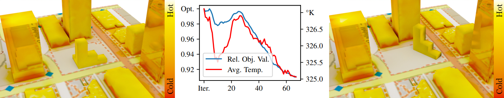

Inverse Simulation of Radiative Thermal Transport
==================================

<p align="center">
  
</p>

This repository is the reference implementation for the paper [*Inverse Simulation of Radiative Thermal Transport*](#paper--citation) (Computer Graphics Forum 44(2), 2025).
It provides a GPU-accelerated system for simulating and optimizing radiative heat transport in urban and
architectural settings.
The forward, as well as the adjoint, simulation runs on the GPU via ray tracing, uses a
differentiable photon-tracing approach, and employs matrix compression to support larger scenes. A novel approximate
edge-sampling scheme re-uses primary samples to resolve visibility discontinuities without explicit edge samples or
auxiliary rays. The system predicts temperature distributions and can automatically optimize a design, for example the placement of buildings or their facade geometry, to improve thermal comfort and avoid problematic configurations.
It supports both steady-state and transient simulations and arbitrary geometric parameterizations.

The renderer is built on top of the Tamashii Renderer framework by [Lukas Lipp](https://fknfilewalker.github.io/), and comes with a related Blender plugin under `tools/blender-thermal-plugin/`.

Paper / Citation
================

If you use this code, please cite the following paper:

> C. Freude, L. Lipp, M. Zezulka, F. Rist, M. Wimmer, and D. Hahn. "Inverse Simulation of Radiative Thermal Transport."
> *Computer Graphics Forum* 44(2), 2025. doi:[10.1111/cgf.70048](https://doi.org/10.1111/cgf.70048).

```bibtex
@article{Freude2025InverseSimulation,
  author  = {Freude, C. and Lipp, L. and Zezulka, M. and Rist, F. and Wimmer, M. and Hahn, D.},
  title   = {Inverse Simulation of Radiative Thermal Transport},
  journal = {Computer Graphics Forum},
  volume  = {44},
  number  = {2},
  eid     = {e70048},
  year    = {2025},
  doi     = {10.1111/cgf.70048},
  publisher = {Wiley},
  note    = {Open access, CC BY 4.0}
}
```

A full version of the paper is available at the [publication page](https://www.cg.tuwien.ac.at/research/publications/2025/freude-2025-iso/).

Contact
-------

For questions, suggestions, or feedback, please open an issue on the [GitHub repository](https://github.com/cfreude/inverse-radiative-thermal-transport) or reach out to the authors directly via the contact details on the [publication page](https://www.cg.tuwien.ac.at/research/publications/2025/freude-2025-iso/).

General Notes
=============

### Requirements:
* [CMake](https://cmake.org/ "CMake") >= 3.14.0
* [Vulkan SDK](https://vulkan.lunarg.com/sdk/home "Vulkan SDK") >= 1.2.162.0
  - On Windows the Vulkan SDK also ships [DXC](https://github.com/microsoft/DirectXShaderCompiler "DXC") (DirectX Shader Compiler), used for HLSL shader compilation. Make sure `VULKAN_SDK` is set to your SDK root (e.g. `C:\VulkanSDK\1.3.268.0`).

### Dependencies:

* submodules in `"root/external/"`
  - [spdlog](https://github.com/gabime/spdlog "spdlog")
  - [nlohmann-json](https://github.com/nlohmann/json "nlohmann-json")
  - [tinygltf](https://github.com/syoyo/tinygltf "tinygltf")
  - [tinyies](https://github.com/fknfilewalker/tinyies "tinyies")
  - [tinyldt](https://github.com/fknfilewalker/tinyldt "tinyldt")
  - [tinyexr](https://github.com/syoyo/tinyexr "tinyexr")
  - [tinyply](https://github.com/ddiakopoulos/tinyply "tinyply")
  - [tinyobjloader](https://github.com/tinyobjloader/tinyobjloader "tinyobjloader")
  - [imgui](https://github.com/ocornut/imgui "imgui")
  - [ImGuizmo](https://github.com/CedricGuillemet/ImGuizmo "ImGuizmo")
  - [imoguizmo](https://github.com/fknfilewalker/imoguizmo "imoguizmo")
  - [stb](https://github.com/nothings/stb "stb")
  - [glm](https://github.com/g-truc/glm "glm")
  - [glslang](https://github.com/KhronosGroup/glslang "glslang") (built from source as a CMake subproject during the build — no prebuilt binaries required)
<!-- * [vcpkg](https://github.com/microsoft/vcpkg "Vcpkg")
  - [spdlog](https://github.com/gabime/spdlog "spdlog") -->

### Notes:
Clone git with submodules
```bash
git clone --recursive
```
If build script is not used, use CMake from `root/` like
```sh
# Adjust `-G <generator-name>` accordingly or remove it
cmake -H. -B_project -G "Visual Studio 16 2019" -A "x64"
```

Compiling On Windows
====================

Use the provided `make.bat` file to generate a Visual Studio project in `root/_project/`. Use `make.bat clean` to remove all project files. If changes to cmake are not visible, delete `root/_project/CMakeCache.txt` and run `make.bat` again.
```sh
make # generate project files in 'root/_project/'
make install # install release build in 'root/_install/'
make install <install_dir> # install release build in <install_dir>
make clean # delete 'root/_project/' and 'root/_install/'
```

DXC (`dxcompiler` / `dxcapi.h`) is taken from the `VULKAN_SDK` install rather than a bundled `external/dxc` directory, so the Vulkan SDK must be installed and `VULKAN_SDK` set on Windows.

Compiling On Linux
==================

Use the provided `makefile` file to generate a project in `root/_project/` or open the CMakeLists.txt file in an IDE like Qt Creator or CLion. Use `make clean` to remove all project files. If changes to cmake are not visible, delete `root/_project/CMakeCache.txt` and run `make.bat` again.

Maybe you have to configure some variables for the Vulkan SDK beforehand.
```
export VULKAN_SDK=/your_path_to_vulkan_sdk/VulkanSDK/1.0.37.0/x86_64
export PATH=$PATH:$VULKAN_SDK/bin
export LD_LIBRARY_PATH=$VULKAN_SDK/
export VK_LAYER_PATH=$VULKAN_SDK/etc/explicit_layer.d
```

Example Usage
=============

Open a scene file:
```sh
thermal_renderer_app.exe -load_scene assets\scenes\city-block.gltf
```

The camera can be moved via the middle mouse button (press: rotate, shift+press: translate, mouse wheel: zoom).  
To compute the temperature distribution for the scene, press the "PRESS TO UPDATE SIMULATION" button.  
To run optimization steps, change the settings in the Optimization submenu and click the "run optim" checkbox.